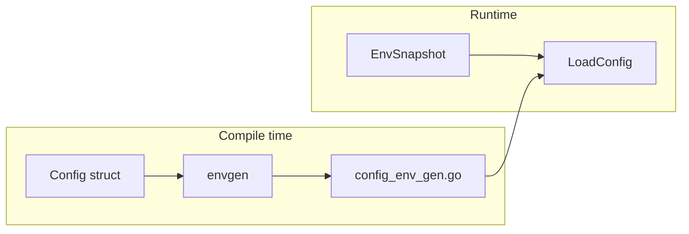

# env

[](https://github.com/gopherust-io/env/actions/workflows/ci.yml)
[](https://scorecard.dev/viewer/?uri=github.com/gopherust-io/env)
[](https://pkg.go.dev/github.com/gopherust-io/env)
[](https://goreportcard.com/report/github.com/gopherust-io/env)
[](LICENSE)

**Blazing-fast, zero-allocation environment configuration for Go.**  
**Blazing-fast load. Contract-grade audit.**

`github.com/gopherust-io/env` parses environment variables into typed structs using compile-time code generation. No reflection at runtime. No external dependencies. One `os.Environ()` pass, then direct field assignment. **Config Doctor** turns the same struct into an enforceable env contract—typos, orphans, silent defaults, unmarked secrets.

Quick links: [Architecture](ARCHITECTURE.md) · [Getting started](docs/GETTING_STARTED.md) · [Examples](examples/basic/) · [Changelog](CHANGELOG.md) · [Scorecard](docs/SCORECARD.md)

```text
  caarlos0/env   12,622 ns/op   244 allocs
  goenv           6,023 ns/op     8 allocs
  viper           3,596 ns/op    70 allocs
  envconfig       3,068 ns/op    81 allocs
  cleanenv        2,737 ns/op    57 allocs
  stdlib            140 ns/op     0 allocs
  env                74 ns/op     0 allocs
```

Benchmark note: Small (10-field) medians from the project bench suite on identical fixtures; directional. Full matrix → [Performance](#performance). Re-run: `make bench-remote VERSION=v0.6.0`.

**New here?** → [docs/GETTING_STARTED.md](docs/GETTING_STARTED.md) (copy-paste guide, CI, troubleshooting)

---

## Start in 3 steps

**1. Install**

```bash
go get github.com/gopherust-io/env@latest
go install github.com/gopherust-io/env/cmd/envgen@latest
```

**2. Struct + generate**

```go
package config

//go:generate envgen -type Config -output config_env_gen.go

type Config struct {
    Port  int    `env:"PORT" default:"8080"`
    Debug bool   `env:"DEBUG"`
    Host  string `env:"HOST" default:"localhost"`
}
```

```bash
go generate ./...
# or: envgen -type Config
# list structs: envgen -list
```

**3. Load**

```go
cfg, err := config.LoadConfig()
if err != nil {
    log.Fatal(err)
}
log.Printf("%+v", cfg.Masked()) // safe if you use sensitive:"true"
```

Optional local `.env`: `_ = env.LoadDotEnv(".env")` before `LoadConfig()`.

Full-featured example: [examples/basic](examples/basic/). Minimal: [examples/minimal](examples/minimal/).

## When not to use `env`

- You need dynamic/untyped runtime schemas from arbitrary keys.
- Your config changes shape frequently and code generation is not acceptable.
- You prefer convenience over strict, explicit typed parsing and compile-time setup.

For those cases, reflection-based config loaders can be a better fit.

---

## Cheatsheet

| I want to… | Do this |
|------------|---------|
| List struct names | `envgen -list` |
| Regenerate loaders | `go generate ./...` |
| Load config | `LoadConfig()` |
| Audit env contract | `envgen doctor -type Config` / `AuditConfig` |
| Reload after env change | `ReloadConfig(&cfg)` |
| Log without secrets | `cfg.Masked()` |
| Skip codegen (dev only) | `reflectenv.Parse(&cfg)` |
| Nested fields | `` DB Database `prefix:"DB_"` `` |
| `${VAR}` in values | `` `expand:"true"` `` on field |

---

## How it works



1. Define a struct with `env` tags.
2. `go generate` runs `envgen` → `LoadConfig`, `ReloadConfig`, `Masked()`, `AuditConfig`.
3. `LoadConfig()` indexes the environment once and assigns fields with zero reflection.

---

## Config Doctor

The Config struct is the contract. `envgen doctor` (and generated `AuditConfig`) checks a snapshot against that schema without touching the zero-alloc load path.

```bash
envgen doctor -type Config -env-file .env -mode prod
```

```text
error: DB_HST is not a known key; did you mean DB_HOST?
warn:  Host (HOST): unset; using default "localhost"
error: DB.Host (DB_HOST): required but unset
```

| Finding | Meaning |
|---------|---------|
| **Typo** | Unknown key within edit distance of a schema key |
| **Orphan** | Unknown key under a known nested `prefix` |
| **Silent default** | Unset field falling back to `default` (error in `-mode prod`) |
| **Missing required** | Required field unset |
| **Unmarked secret** | Value looks like a token but field lacks `sensitive:"true"` |

```go
rep := config.AuditConfigWithOptions(snap, env.AuditOptions{Mode: env.AuditModeProd})
if err := rep.Err(); err != nil {
    log.Fatal(err)
}
```

Try the planted typos in [examples/basic/.env.doctor](examples/basic/.env.doctor):

```bash
go run ./cmd/envgen doctor -dir ./examples/basic -type Config \
  -env-file ./examples/basic/.env.doctor -mode prod -prefix DB_
```

Flags: `-mode dev|prod`, `-format text|json`, `-strict-unknown`, `-all-unknown`, `-prefix`, `-env-file`.

---

## Struct tags

| Tag | Description |
|-----|-------------|
| `env:"KEY"` | Environment variable name |
| `default:"..."` | Value when unset |
| `required:"true"` | Error if unset and no default |
| `prefix:"FOO_"` | Prefix for nested struct fields |
| `sep:","` | Slice separator (default `,`) |
| `kvsep:":"` | Map key/value separator (default `:`) |
| `layout:"..."` | `time.Time` parse layout (default RFC3339) |
| `expand:"true"` | Expand `${VAR}` and `$VAR` in values |
| `sensitive:"true"` | Redact in `Masked()` |
| `env:"-"` | Skip field |

Nested prefixes compose: `prefix:"DB_"` + `env:"HOST"` → `DB_HOST`.

---

## Generated API

| Function | Description |
|----------|-------------|
| `LoadConfig()` | Parse env into `Config` |
| `ReloadConfig(cfg *Config)` | Re-parse env in-place |
| `LoadConfigFrom(snap)` | Parse from a custom snapshot |
| `MustLoadConfig()` | Panics on error |
| `(Config) Masked()` | Copy with sensitive fields redacted |
| `AuditConfig(snap)` | Contract audit (typos, orphans, …) |
| `AuditConfigFromEnviron()` | Audit against process env |
| `AuditConfigWithOptions(snap, opts)` | Audit with mode / strict flags |

Errors are collected in one pass:

```text
env: DB.Host (DB_HOST): required; Port (PORT): parse: strconv.Atoi: parsing "abc": invalid syntax
```

---

## Local development (.env)

```go
_ = env.LoadDotEnv(".env")
cfg, err := config.LoadConfig()
```

`LoadDotEnv` fills unset variables from a file and refreshes the snapshot. Existing process variables are preserved.

Read-only merge without touching `os.Environ()`:

```go
snap, err := env.SnapshotWithDotEnv(".env")
cfg, err := config.LoadConfigFrom(snap)
```

---

## Variable expansion

```go
BaseURL string `env:"BASE_URL" default:"${NATS_URL}/api" expand:"true"`
```

Supports `${VAR}` and `$VAR` syntax.

---

## Hot reload

```go
cfg, _ := config.LoadConfig()
os.Setenv("PORT", "9090")
_ = config.ReloadConfig(&cfg)
```

---

## Cross-package nested structs

```go
import "myapp/internal/db"

type Config struct {
    DB db.Database `prefix:"DB_"`
}
```

---

## Reflection fallback (opt-in)

```go
import "github.com/gopherust-io/env/reflectenv"

var cfg Config
reflectenv.Parse(&cfg)
```

Slower than codegen — use `envgen` in production.

---

## Custom types

```go
type Mode string

func (m *Mode) UnmarshalEnv(key, value string) error {
    switch value {
    case "dev", "staging", "prod":
        *m = Mode(value)
        return nil
    default:
        return fmt.Errorf("unknown mode %q", value)
    }
}
```

---

## Migration from caarlos0/env

| caarlos0/env | env |
|--------------|-----|
| `env.Parse(&cfg)` | `LoadConfig()` |
| `envDefault:"8080"` | `default:"8080"` |
| `envPrefix:"DB_"` | `prefix:"DB_"` |
| `env:"HOST,required"` | `env:"HOST" required:"true"` |

---

## Performance

Codegen load is faster and zero-alloc vs reflection loaders on identical fixtures.

| Library | Approach | Benchmark |
|---------|----------|-----------|
| **env** (this) | Codegen, no reflection | `*Envgen` |
| stdlib | Hand-written `LookupEnv` + `strconv` | `*Stdlib` |
| cleanenv | Reflection | `*Cleanenv` |
| envconfig | Reflection | `*Envconfig` |
| viper | `AutomaticEnv` + mapstructure | `*Viper` |
| goenv | Low-allocation reflection | `*Goenv` |
| caarlos0/env | Reflection | `*Carl` |

### Small config (10 fields)

| Library | ns/op | allocs/op | vs env |
|---------|------:|----------:|-------:|
| **env** | **74** | **0** | 1× |
| stdlib | 140 | 0 | ~2× |
| cleanenv | 2,737 | 57 | ~37× |
| envconfig | 3,068 | 81 | ~42× |
| viper | 3,596 | 70 | ~49× |
| goenv | 6,023 | 8 | ~82× |
| caarlos0/env | 12,622 | 244 | ~172× |

### Scaling (env)

| Fixture | env | allocs |
|---------|----:|-------:|
| Small (10) | 74 ns | 0 |
| Medium (50) | 402 ns | 0 |
| Large (100) | 977 ns | 0 |

Platform: darwin/arm64 (Apple M4 Pro). Medians of `-count=10` from [`bench/`](bench/). Directional; re-run on your hardware:

```bash
make bench-remote VERSION=v0.6.0
```

Details and Medium/Large matrices: [bench/README.md](bench/README.md). Sample output: [bench/results.sample.txt](bench/results.sample.txt).

---

## Runtime API

```go
snap := env.Snapshot()
snap.Lookup("PORT")
env.ParseInt("8080")
env.LoadDotEnv(".env")
env.Reload()
```

## Compatibility and stability

- Supported Go version: follow `go.mod` in this repository.
- Public generated API (`LoadConfig`, `ReloadConfig`, `Masked`) is stable across patch releases.
- Breaking changes are called out in [CHANGELOG.md](CHANGELOG.md).

---

## Changelog

See [CHANGELOG.md](CHANGELOG.md).

[Contributing](CONTRIBUTING.md) · [Security](SECURITY.md)

## License

MIT — see [LICENSE](LICENSE).
